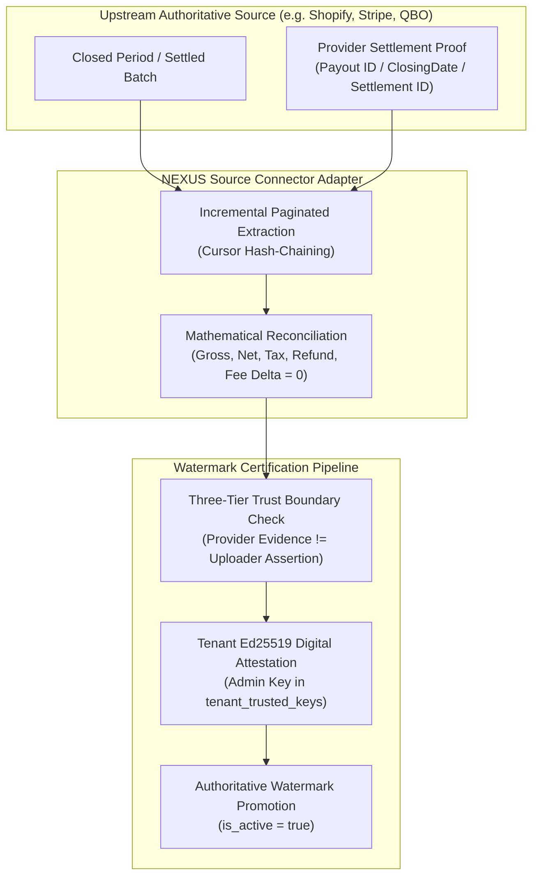

# NEXUS Authoritative Source Completeness Contract

**Specification Version:** 1.0.0
**Phase:** 1J.0 Architecture
**Status:** Approved for Implementation
**Classification:** Core Governance & Safety Architecture

---

## 1. Executive Summary and Invariant Intent

The NEXUS platform ingests commercial transaction data to compute customer behavioral metrics, cadence analytics, churn probabilities, and personalized interventions. In accordance with safety policies established in Phases 1F through 1I, automated customer outreach and predictive interventions must remain **strictly disabled** (`DIAGNOSTIC_ONLY`) until the ingested dataset is mathematically, cryptographically, and operationally proven to be **complete and authoritative**.

This document defines the formal **Authoritative Source Completeness Contract**. Any upstream source connector (e.g., Shopify, Stripe, QuickBooks Online, Square, Xero) integrating with NEXUS must adhere strictly to this contract before an ingestion batch can qualify for watermark registration or promotion.



---

## 2. Three-Tier Trust Boundary Architecture

NEXUS enforces strict separation between three distinct tiers of data integrity:

| Trust Tier | Source of Authority | Tamper Resistance | NEXUS Acceptance Criteria |
| :--- | :--- | :--- | :--- |
| **Tier 1: Uploader Assertion** | Metadata supplied by the API caller, merchant admin, or CSV uploader. | Low (client can submit arbitrary claims). | **Never accepted alone.** Cannot establish source completeness or satisfy safety gates. |
| **Tier 2: Authenticated Application Metadata** | Session context, tenant database records, and gateway job state verified by NEXUS authentication (`get_current_user`). | High (within NEXUS security boundary). | Validates tenant identity, user permissions, and dataset row counts. |
| **Tier 3: Independently Authenticated Source Evidence** | Direct API responses, cryptographic webhook signatures, and settlement receipts from the upstream financial platform. | Highest (external platform cryptographic proof). | **Mandatory requirement** for provisional watermark creation and promotion. |

> [!CRITICAL]
> A tenant or user assertion claiming that "all sales for month X are uploaded" is treated as **Tier 1 (Uploader Assertion)**. Under no circumstances may an authoritative watermark be created without direct **Tier 3 (Independently Authenticated Source Evidence)**.

---

## 3. Contract Schema & Invariants

An Authoritative Source Completeness Checkpoint is represented by an immutable manifest contract containing the following ten canonical sections:

### 3.1. Source Identity and Tenant Binding
- `provider`: String enumeration (`shopify`, `stripe`, `quickbooks_online`, `square`, `xero`).
- `provider_account_id`: The immutable upstream tenant account identifier (e.g., `acct_1234567890` for Stripe, `shop_name.myshopify.com` for Shopify, `realm_id` for QBO).
- `business_id`: The NEXUS tenant UUID (`ab044b1a-835a-4a38-bf45-62fe38624151` for Apex Specialty Commerce).
- `credential_fingerprint`: SHA-256 hash of the tenant connector credential reference used to authorize the extraction.
- **Invariant:** `provider_account_id` must be cryptographically verified against the active `TenantConnectorCredential` registered for `business_id`. Cross-tenant extraction is strictly rejected.

### 3.2. Period Boundaries and Timezone Normalization
- `period_start`: ISO-8601 UTC timestamp (inclusive, e.g., `2026-09-01T00:00:00Z`).
- `period_end`: ISO-8601 UTC timestamp (inclusive, e.g., `2026-09-30T23:59:59Z`).
- `source_timezone`: IANA standard timezone string (e.g., `America/New_York`, `UTC`).
- `closed_at`: ISO-8601 UTC timestamp indicating when the period was sealed upstream.
- **Invariant:** All transaction timestamps extracted from the source must be deterministically mapped to UTC. `period_end` must be strictly earlier than `closed_at`.

### 3.3. Source-Native Settlement and Close Identifiers
To prevent arbitrary cutoff manipulation, the checkpoint must bind to a native, immutable closure artifact from the source system:
- **Stripe:** `payout_id` (`po_...`) with status `paid` and `balance_transaction_id` summary.
- **Shopify:** `shopify_payout_id` or `daily_close_batch_id` linked to Shopify Payments settlement.
- **QuickBooks Online:** `ClosingDate` in `CompanyPreferences` where `period_end <= ClosingDate` and `CloseDateEnabled == true`.
- **Xero:** `PeriodLockDate` in `Organisation` settings where `period_end <= PeriodLockDate`.
- **Square:** `settlement_id` (`settlement_...`) with status `SENT`.
- **Invariant:** If the upstream system lacks an automated closing lock, the connector must supply an external bank deposit settlement reference or dual-signed operational close certificate.

### 3.4. Transaction Coverage & Monotonic Sequence Invariants
Every transaction extracted within the period bounds must satisfy deterministic completeness:
- `transaction_count`: Exact non-negative integer of transactions within `[period_start, period_end]`.
- `transaction_id_list_hash`: Hex-encoded SHA-256 digest of the lexicographically sorted list of upstream transaction IDs.
  $$\text{Hash} = \text{SHA-256}\left(\sum_{i=1}^{N} \text{ID}_i^{\text{sorted}}\right)$$
- `cursor_chain_hash`: SHA-256 digest chaining all sequential pagination cursors visited during extraction:
  $$H_0 = \text{SHA-256}(\text{"ROOT"}), \quad H_k = \text{SHA-256}(H_{k-1} \,\|\, C_k)$$
- **Invariant:** If pagination terminates prematurely (e.g., HTTP timeout, page drop, cursor truncation), `cursor_chain_hash` will fail verification and the batch will be discarded.

### 3.5. Transaction Status Handling
Transactions within the extraction window are classified into strict lifecycle states:

| Source Status | Classification | Ingestion Action | Revenue Accounting |
| :--- | :--- | :--- | :--- |
| `AUTHORIZED` | Unsettled / Pending | **Ignored** (or flagged pending) | Excluded from gross & net sales |
| `CAPTURED` / `PAID` / `SETTLED` | Finalized Sale | **Ingested** | Included in gross sales |
| `REFUNDED` (Full) | Nullified Sale | **Ingested** as Sale + Refund | Included in gross, subtracted in net |
| `PARTIALLY_REFUNDED` | Adjusted Sale | **Ingested** with Refund items | Line-item gross maintained, net adjusted |
| `DISPUTED` / `CHARGEBACK` | Contested | **Ingested** with Dispute flag | Provisionally debited against net |
| `VOIDED` / `CANCELLED` | Abandoned | **Quarantined** / Non-revenue | Zero revenue impact |

### 3.6. Mathematical Reconciliation Formulas
The connector must compute and reconcile the five fundamental financial metrics:

1. **Gross Sales:**
   $$\text{GrossSales} = \sum_{\text{Items}} (\text{Quantity} \times \text{UnitPrice})$$
2. **Net Sales:**
   $$\text{NetSales} = \text{GrossSales} - \text{TotalDiscounts} - \text{TotalRefunds}$$
3. **Total Collected:**
   $$\text{TotalCollected} = \text{NetSales} + \text{TotalTaxes} + \text{ShippingHandling}$$
4. **Net Settled to Bank:**
   $$\text{NetSettled} = \text{TotalCollected} - \text{PaymentProcessingFees}$$
5. **Reconciliation Invariant:**
   $$\left|\text{SourceNetSettled} - \text{IngestedNetSettled}\right| = \$0.00$$
   Any non-zero discrepancy between source financial receipts and ingested database totals triggers immediate ingestion rejection.

---

## 4. Cryptographic Attestation Protocol

Completeness certification requires two complementary cryptographic artifacts:

```
[Upstream Platform API/Webhook]
        |  (HMAC-SHA256 signature / TLS Attestation)
        v
[Tier 3: Platform Settlement Evidence]
        +
[NEXUS Mathematical Reconciliation Check (Delta = $0.00)]
        +
[Tenant Admin Ed25519 Attestation Signature]
        |
        v
[Certified Authoritative Watermark]
```

1. **Platform Evidence Token:**
   - Raw payload of upstream settlement object (e.g., Stripe Payout JSON or QBO CompanyPreferences XML/JSON).
   - Upstream signature header (e.g., `Stripe-Signature` or `X-Shopify-Hmac-Sha256`).
   - Connector verification timestamp and TLS certificate public key thumbprint.

2. **Merchant Attestation:**
   - Canonical JSON representation of the `SignedPeriodCloseManifest`.
   - Ed25519 digital signature generated using the merchant's private signing key.
   - Verification against public key stored in `tenant_trusted_keys` (enforcing active status and rotation lifecycle as proven in Phase 1I.5).

---

## 5. Backfill, Invalidation, and Dispute Handling

If historical records are modified upstream after period closure (e.g., late refund, retroactive chargeback, reopened accounting period):

1. **Watermark Immutability:** An existing active watermark is never overwritten in place.
2. **Forward Adjustments (Default):** Standard adjustments occurring after `period_end` are recorded as adjustment events in the **subsequent** period, preserving the historical close.
3. **Emergency Invalidation Protocol:**
   - If upstream reports a retroactive alteration of transactions inside `[period_start, period_end]`:
   - The connector automatically emits a `REVOKE_WATERMARK` event.
   - The active watermark has `is_active` set to `false`, with `invalidated_at = NOW()` and `invalidation_reason = 'UPSTREAM_RETROACTIVE_MUTATION'`.
   - Downstream safety gates (`CadenceSafetyGate`) immediately drop to `DIAGNOSTIC_ONLY`.
   - All automated outreach remains locked until a new certified period close is submitted.

---

## 6. Implementation Verification Matrix

| Requirement | Verification Mechanism | Phase 1J.0 Status |
| :--- | :--- | :--- |
| **Tenant Isolation** | Multi-tenant credential binding & business_id isolation in DB | Approved |
| **Source Evidence** | Cryptographically signed settlement artifact required | Approved |
| **Pagination Integrity** | SHA-256 cursor chain validation | Approved |
| **Exact Reconciliation** | Zero-delta gross, tax, refund, fee validation | Approved |
| **Key Lifecycle** | Enforced via `tenant_trusted_keys` (018/019 migrations) | Proven in 1I.5 |
| **Adversarial Hardening** | Replay defense, key rotation, signer identity verification | Proven in 1I.5 |

*(End of Contract Specification)*
