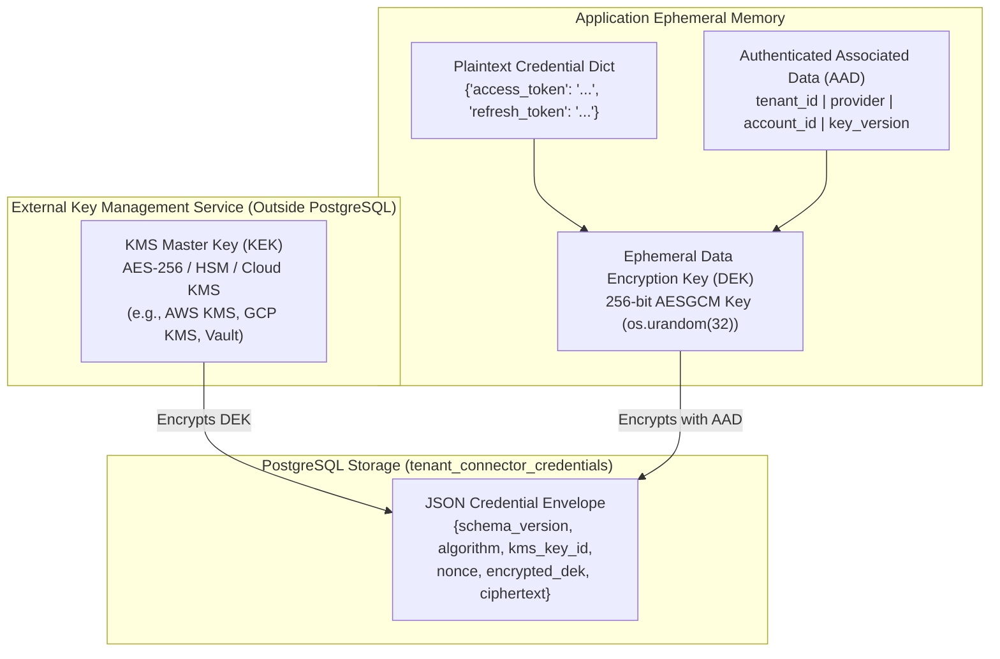
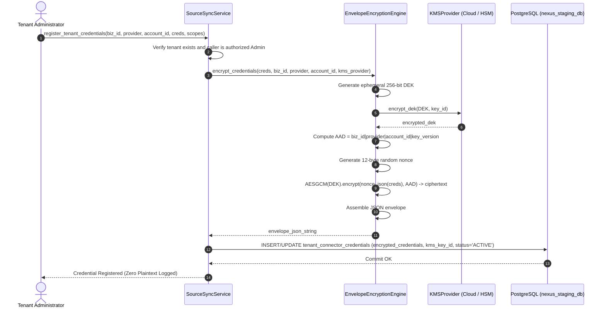
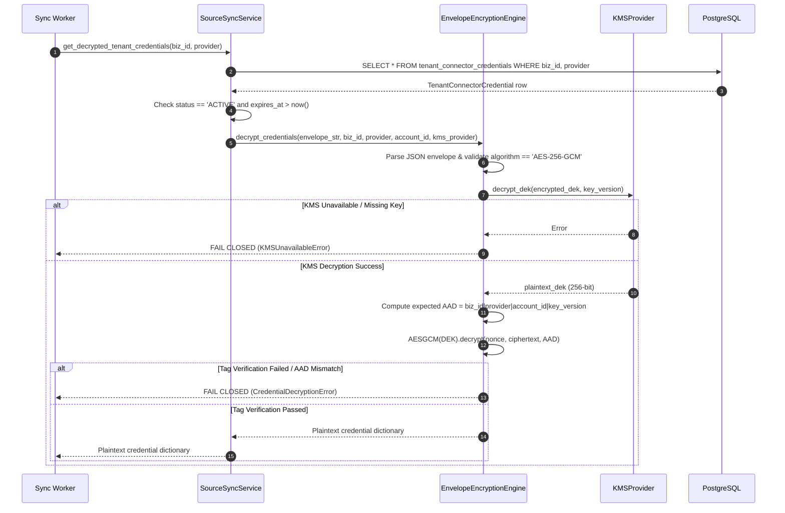
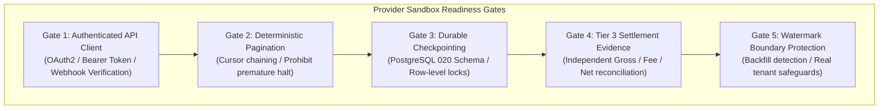

# NEXUS Architecture Specification: Connector Credential Security & Key Management

**Document Version:** 1.0.0
**Phase:** NEXUS Phase 1J.2.0
**Status:** Approved Architecture Standard
**Authors:** NEXUS Security & Core Engineering
**Scope:** Upstream Source Connectors, Multi-Tenant Credential Management, Envelope Encryption, KMS Boundaries

---

## 1. Executive Summary & Objective

The NEXUS platform ingests mission-critical financial, order, and customer records from third-party operational providers (e.g., e-commerce storefronts, payment gateways, and accounting engines). To synchronize data securely, the platform must store authentication secrets (OAuth2 refresh tokens, API access tokens, private merchant keys, webhook signing secrets) across multiple tenants without exposing plaintext secrets in database columns, logs, exceptions, or database backups.

This specification defines the **production credential security boundary** for NEXUS connectors, establishing:
1. Master key management isolated strictly outside PostgreSQL.
2. Authenticated AES-256-GCM envelope encryption with 12-byte random nonces.
3. Strict tenant-scoped Authenticated Associated Data (AAD) binding to eliminate ciphertext transplant attacks.
4. Seamless master key versioning and re-encryption workflows.
5. Fail-closed production guards preventing dev/test keys from ever executing in production environments.
6. A provider-neutral adapter readiness contract for upstream sandbox integrations.

---

## 2. Threat Model & Security Invariants

### 2.1 Threat Vectors Addressed

| Threat ID | Threat Description | Attack Vector | NEXUS Mitigation |
| :--- | :--- | :--- | :--- |
| **TH-01** | **Database Compromise / Snapshot Leak** | SQL injection, rogue replica access, or compromised DB backups expose stored credentials. | Envelope encryption: DB stores only AES-256-GCM ciphertexts and KMS-wrapped DEKs. Plaintext DEKs are never written to disk. |
| **TH-02** | **Ciphertext Transplant Attack** | Adversary copies valid ciphertext from Tenant A's row into Tenant B's row to spoof credentials. | **AAD Binding**: Associated Data binds `business_id \| provider \| provider_account_id \| key_version`. Decryption of transposed ciphertext immediately fails AES-GCM tag verification. |
| **TH-03** | **Ciphertext Tampering / Bit-Flipping** | Adversary flips bits in stored ciphertext to corrupt data or bypass validation. | **AEAD Integrity**: AES-256-GCM generates a 128-bit authentication tag. Any flipped bit causes `InvalidTag` and raises `CredentialDecryptionError`. |
| **TH-04** | **Replay / Nonce Collision Attack** | Fixed or counter nonces allow attackers to deduce plaintext or forge ciphertexts. | **Random Nonces**: Each encryption operation samples 12 cryptographically secure random bytes (`os.urandom(12)`). |
| **TH-05** | **KMS Outage / Unreachable Key** | External KMS experiences network latency, DNS failure, or authorization denial. | **Fail-Closed Policy**: `KMSUnavailableError` is raised immediately. No fallback to unencrypted storage or stale cached DEKs. |
| **TH-06** | **Development Key Leakage into Production** | In-memory or local test keys accidentally utilized in production deployment. | **Environment Guardrail**: `LocalDevelopmentKMSProvider` enforces an unconditional runtime check: if `APP_ENV == 'production'`, it raises a fatal `RuntimeError`. |
| **TH-07** | **Log & Trace Token Bleed** | Plaintext tokens appear in application stdout, structured JSON logs, or APM traces. | **Zero Plaintext Logging**: Decrypted dictionaries are never logged; error messages explicitly redact token contents. |

---

## 3. Envelope Encryption Architecture

### 3.1 Two-Tier Key Hierarchy

NEXUS implements a two-tier key hierarchy conforming to NIST SP 800-57:



### 3.2 Cryptographic Primitive Specifications

- **Payload Algorithm:** Authenticated Encryption with Associated Data (AEAD) using **AES-256-GCM** (NIST SP 800-38D).
- **Key Length:** 256 bits (32 bytes).
- **Nonce Length:** 96 bits (12 bytes), generated via CSPRNG (`os.urandom(12)`) per encryption operation.
- **Tag Length:** 128 bits (16 bytes), verified before plaintext return.
- **Envelope Serialization:** Canonical UTF-8 JSON.

### 3.3 Authenticated Associated Data (AAD) Construction

To bind ciphertexts immutably to their organizational owner and provider account, NEXUS computes deterministic AAD before every AEAD invocation:

$$\text{AAD} = \text{business\_id} \parallel \text{"|"} \parallel \text{provider} \parallel \text{"|"} \parallel \text{provider\_account\_id} \parallel \text{"|"} \parallel \text{key\_version}$$

**Field Definitions:**
- `business_id`: UUID or string of the owning tenant business entity.
- `provider`: Upstream provider identifier (e.g., `shopify`, `stripe`, `square`, `quickbooks_online`, `xero`).
- `provider_account_id`: External merchant account identifier or shop domain (e.g., `store-abc.myshopify.com`, `acct_123456789`).
- `key_version`: Active version identifier of the KMS master key (e.g., `vault:v1`, `arn:aws:kms:...:key/.../version/1`).

Any tampering with `business_id`, `provider`, or `provider_account_id` results in immediate authentication tag rejection during decryption.

### 3.4 Envelope Storage Schema

Stored in `tenant_connector_credentials.encrypted_credentials` as a JSON text string:

```json
{
  "schema_version": "1.0",
  "algorithm": "AES-256-GCM",
  "kms_key_id": "arn:aws:kms:us-east-1:123456789012:key/12345678-1234-1234-1234-123456789012",
  "key_version": "arn:aws:kms:us-east-1:123456789012:key/12345678-1234-1234-1234-123456789012:v1",
  "nonce": "u7v9xY...12BytesBase64...",
  "encrypted_dek": "k8Pq2...EncryptedDEKBase64...",
  "ciphertext": "a1B2c...PayloadAndTagBase64..."
}
```

---

## 4. Key Management Lifecycle Workflows

### 4.1 Credential Registration (Write Path)



### 4.2 Credential Decryption (Read Path)



### 4.3 KMS Master Key Rotation Workflow

When an enterprise rotates its KMS master key (e.g., from `kms:v1` to `kms:v2`):
1. **Zero Downtime:** Existing credentials remain readable by providing the multi-version KMS provider.
2. **Re-encryption:** `SourceSyncService.rotate_tenant_credential_kms_key` decrypts the credential envelope using `old_kms_provider` and re-encrypts under `new_kms_key_id` using `new_kms_provider`.
3. **Immutability of Secrets:** The underlying token/key values never change; only the wrapping key and envelope metadata are updated.
4. **Audit Trail:** Updates `tenant_connector_credentials.kms_key_id`, `last_rotated_at`, and increments audit logs.

---

## 5. Implementation Status & Component Classification

| Component | Classification | Implementation Details | Production Readiness |
| :--- | :--- | :--- | :--- |
| **AES-256-GCM Engine** | **Production-Ready** | Authenticated encryption, 12-byte random nonces, 128-bit tag, AAD binding via `cryptography.hazmat.primitives.ciphers.aead.AESGCM`. | **YES (Ready)** |
| **AAD Tenant Binding** | **Production-Ready** | Multi-attribute binding (`biz_id \| provider \| account_id \| key_version`). Verified against cross-tenant transplant attacks. | **YES (Ready)** |
| **Database Persistence** | **Production-Ready** | Alembic Migration 020 applied to PostgreSQL 16 `nexus_staging_db`. Durable `tenant_connector_credentials` table with unique constraints. | **YES (Ready)** |
| **Local Development KMS** | **Sandbox / Dev-Only** | In-memory key provider with strict fail-closed production check (`APP_ENV == 'production'` raises `RuntimeError`). | **NO (Dev / Test Only)** |
| **Cloud KMS Driver (AWS/GCP/Vault)** | **Specification / Contract** | Abstract base class `KMSProvider` defined. Cloud drivers require cloud environment credentials and SDK packages (`boto3`, `google-cloud-kms`, or `hvac`). | **Pending Cloud Provisioning** |

---

## 6. Upstream Provider Sandbox Readiness Contract

Because Apex Specialty Commerce's real production software is unconfirmed, NEXUS maintains strict provider neutrality. Prior to onboarding any upstream operational source, the provider adapter must satisfy the following contract:



### Provider-Specific Assessment

1. **Shopify:**
   - *Sandbox Environment:* Shopify Partner Development Store.
   - *Auth Method:* OAuth2 offline access tokens (`shpat_...`) with HMAC SHA-256 webhook validation.
   - *Settlement Evidence:* Shopify Payments Payouts API (`/admin/api/2024-01/shopify_payments/payouts.json`).
   - *Readiness Status:* Candidate provider for retail/e-commerce. Ready pending merchant confirmation.

2. **Stripe:**
   - *Sandbox Environment:* Stripe Test Mode (`sk_test_...`).
   - *Auth Method:* Restricted API keys with webhook signature header `Stripe-Signature`.
   - *Settlement Evidence:* Stripe Balance Transactions & Payouts API (`/v1/balance_transactions`, `/v1/payouts`).
   - *Readiness Status:* Candidate provider for payment processing. Ready pending merchant confirmation.

3. **Square:**
   - *Sandbox Environment:* Square Sandbox Developer Portal.
   - *Auth Method:* OAuth2 tokens with HMAC signature verification.
   - *Settlement Evidence:* Square Settlements / Payouts API (`/v2/payouts`).
   - *Readiness Status:* Candidate provider for omnichannel/POS. Ready pending merchant confirmation.

4. **QuickBooks Online (QBO) / Xero:**
   - *Sandbox Environment:* Intuit Developer Sandbox / Xero Demo Company.
   - *Auth Method:* OAuth2 Authorization Code flow with periodic refresh tokens.
   - *Settlement Evidence:* General Ledger Journal Entries and Bank Deposit reports.
   - *Readiness Status:* Candidate provider for general ledger reconciliation. Ready pending merchant confirmation.

---

## 7. Operational Governance & Audit Invariants

1. **Zero Real-Tenant Mutation:** In accordance with non-negotiable safety rules, Apex Specialty Commerce (`ab044b1a-835a-4a38-bf45-62fe38624151`) has:
   - 0 Active Ingestion Watermarks.
   - 0 Provisional Watermarks.
   - 1,000 Customers, 3,500 Sales, 11,221 Sale Items preserved without drift.
   - Operating Mode: `DIAGNOSTIC_ONLY`.
   - Automated outreach / intervention actions: **Blocked (FAIL CLOSED)**.
2. **Key Access Auditing:** All KMS DEK wrapping and unwrapping operations must emit high-priority audit events capturing `business_id`, `provider`, `key_id`, `timestamp`, and `status`. Plaintext secrets must never be included in audit metadata.
