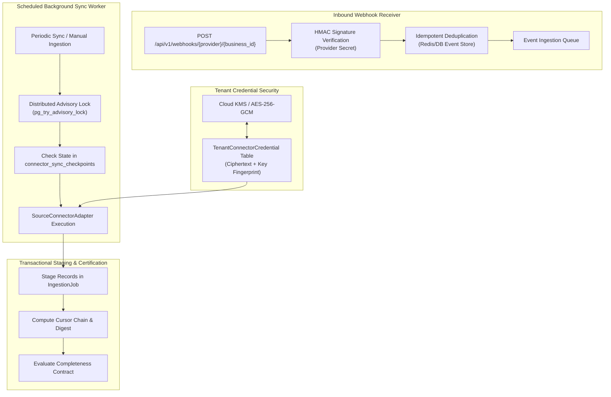

# NEXUS Source Connector Interface Architecture

**Specification Version:** 1.0.0
**Phase:** 1J.0 Architecture
**Status:** Approved for Implementation
**Classification:** Core Connector & Ingestion Architecture

---

## 1. Architectural Overview

The NEXUS Source Connector subsystem serves as the secure, fault-tolerant ingestion bridge between external commercial systems (e.g. Shopify, Stripe, QuickBooks Online, Square) and the internal NEXUS customer data platform.

To ensure strict tenant isolation, zero credential leakage, and uncompromising data integrity, the connector architecture is organized around four core pillars:



---

## 2. Standardized `SourceConnectorAdapter` Interface

Every upstream provider adapter inherits from the abstract base class `SourceConnectorAdapter`, ensuring uniform behavior, metrics, and error semantics across all integrations.

```python
"""
NEXUS Abstract Source Connector Adapter Interface
Location: backend/app/data/connectors/adapter.py
"""

from abc import ABC, abstractmethod
from datetime import datetime
from decimal import Decimal
from typing import AsyncIterator, Dict, Any, List, Optional
from pydantic import BaseModel, Field


class ExtractionCheckpoint(BaseModel):
    cursor: Optional[str] = None
    page_number: int = 0
    records_extracted: int = 0
    cursor_chain_hash: str = Field(description="SHA-256 rolling chain of pagination cursors")
    last_record_timestamp: Optional[datetime] = None


class ExtractedTransaction(BaseModel):
    source_transaction_id: str
    transaction_number: Optional[str] = None
    customer_source_id: Optional[str] = None
    customer_email: Optional[str] = None
    transaction_date: datetime
    status: str
    currency: str
    gross_amount: Decimal
    discount_amount: Decimal
    tax_amount: Decimal
    net_amount: Decimal
    fee_amount: Decimal
    line_items: List[Dict[str, Any]]
    raw_payload_hash: str


class SettlementEvidence(BaseModel):
    provider: str
    settlement_id: str
    settlement_status: str
    settlement_date: datetime
    currency: str
    gross_amount: Decimal
    net_amount: Decimal
    tax_amount: Decimal
    fee_amount: Decimal
    source_raw_evidence: Dict[str, Any]
    provider_signature: str
    evidence_digest: str


class SourceConnectorAdapter(ABC):
    """
    Abstract adapter interface enforcing the Authoritative Source Completeness Contract.
    """

    def __init__(self, tenant_credentials: Dict[str, Any], business_id: str):
        self.credentials = tenant_credentials
        self.business_id = business_id

    @abstractmethod
    async def validate_credentials(self) -> bool:
        """
        Verify that tenant credentials are valid, unexpired, and possess required scopes.
        """
        pass

    @abstractmethod
    async def fetch_period_bounds(self) -> Dict[str, datetime]:
        """
        Query the upstream system for the latest authoritative closed period boundaries
        (e.g., last completed payout date, accounting ClosingDate, or daily close).
        """
        pass

    @abstractmethod
    def stream_transactions(
        self,
        start_time: datetime,
        end_time: datetime,
        checkpoint: Optional[ExtractionCheckpoint] = None,
    ) -> AsyncIterator[ExtractedTransaction]:
        """
        Stream transactions within [start_time, end_time] using deterministic cursor pagination.
        Must update and yield ExtractionCheckpoint state.
        """
        pass

    @abstractmethod
    async def fetch_settlement_evidence(self, settlement_identifier: str) -> SettlementEvidence:
        """
        Fetch authoritative cryptographic settlement proof directly from the provider.
        """
        pass

    @abstractmethod
    def verify_webhook_signature(
        self,
        headers: Dict[str, str],
        body_bytes: bytes,
        webhook_secret: str,
    ) -> bool:
        """
        Validate provider webhook HMAC-SHA256 signature and timestamp tolerance window.
        """
        pass

    @abstractmethod
    async def refresh_access_token_if_needed(self) -> Optional[Dict[str, Any]]:
        """
        Perform automated OAuth token refresh if access token is nearing expiration.
        Returns updated credential dictionary for re-encryption, or None if unchanged.
        """
        pass
```

---

## 3. Tenant Credential Storage & KMS Envelope Encryption

To prevent credential leakage and strictly preserve tenant boundaries:

### 3.1. Database Model: `TenantConnectorCredential`

```sql
CREATE TABLE tenant_connector_credentials (
    id UUID PRIMARY KEY DEFAULT gen_random_uuid(),
    business_id UUID NOT NULL REFERENCES businesses(id) ON DELETE CASCADE,
    provider VARCHAR(64) NOT NULL,
    provider_account_id VARCHAR(255) NOT NULL,
    encrypted_credentials BYTEA NOT NULL,
    kms_key_id VARCHAR(255) NOT NULL,
    nonce BYTEA NOT NULL,
    auth_tag BYTEA NOT NULL,
    status VARCHAR(32) NOT NULL DEFAULT 'ACTIVE', -- ACTIVE, EXPIRED, REVOKED
    expires_at TIMESTAMPTZ,
    last_rotated_at TIMESTAMPTZ NOT NULL DEFAULT NOW(),
    created_at TIMESTAMPTZ NOT NULL DEFAULT NOW(),
    updated_at TIMESTAMPTZ NOT NULL DEFAULT NOW(),
    CONSTRAINT uq_tenant_provider UNIQUE (business_id, provider)
);

CREATE INDEX idx_tenant_credentials_lookup ON tenant_connector_credentials(business_id, provider);
```

### 3.2. Encryption Specification
- **Algorithm:** AES-256-GCM authenticated envelope encryption.
- **Master Key:** Cloud KMS or localized master encryption key (`NEXUS_CONNECTOR_MASTER_KEY`).
- **Data Encryption Key (DEK):** Unique per tenant and credential rotation.
- **Zero-Plaintext Invariant:** Plaintext tokens exist only in transient local variable scopes during active API calls; credentials are never written to logs, error traces, or serialized API responses.

---

## 4. Inbound Webhook Receiver Architecture

To ingest real-time events without polling lag, NEXUS provides a hardened webhook ingress point:

### 4.1. Endpoint Specification
- **Path:** `POST /api/v1/webhooks/{provider}/{business_id}`
- **Authentication:** Provider HMAC signature validation (no session cookie or JWT required; authentication derived from shared secret bound to `business_id`).

### 4.2. Verification & Replay Defense Flow
```
1. Caller sends POST with provider headers (e.g., Stripe-Signature, X-Shopify-Hmac-Sha256).
2. Gateway resolves business_id and retrieves tenant webhook secret from vault.
3. Validate timestamp within ±300s window (prevents replay attacks).
4. Compute HMAC-SHA256(raw_body_bytes, secret) using constant-time comparison (hmac.compare_digest).
5. Check event_id against Redis/Postgres deduplication store:
   - If event_id exists: return HTTP 200 (idempotent acknowledge, skip processing).
   - If event_id new: persist event_id, enqueue payload to background worker, return HTTP 202 Accepted.
```

---

## 5. Background Sync Worker & Durable Checkpoints

Long-running batch sync operations must survive worker crashes, network interruptions, and rate-limiting throttling:

### 5.1. Database Model: `connector_sync_checkpoints`

```sql
CREATE TABLE connector_sync_checkpoints (
    id UUID PRIMARY KEY DEFAULT gen_random_uuid(),
    business_id UUID NOT NULL REFERENCES businesses(id) ON DELETE CASCADE,
    provider VARCHAR(64) NOT NULL,
    period_start TIMESTAMPTZ NOT NULL,
    period_end TIMESTAMPTZ NOT NULL,
    status VARCHAR(32) NOT NULL DEFAULT 'IN_PROGRESS', -- IN_PROGRESS, COMPLETED, FAILED, PAUSED
    current_cursor TEXT,
    cursor_chain_hash VARCHAR(64) NOT NULL,
    records_extracted INTEGER NOT NULL DEFAULT 0,
    gross_extracted_amount NUMERIC(14, 2) NOT NULL DEFAULT 0.00,
    retry_count INTEGER NOT NULL DEFAULT 0,
    last_error TEXT,
    started_at TIMESTAMPTZ NOT NULL DEFAULT NOW(),
    updated_at TIMESTAMPTZ NOT NULL DEFAULT NOW(),
    CONSTRAINT uq_sync_period UNIQUE (business_id, provider, period_start, period_end)
);
```

### 5.2. Worker Execution Lifecycle
1. **Advisory Locking:** Worker acquires PostgreSQL transaction advisory lock:
   $$\text{pg\_try\_advisory\_xact\_lock}(\text{hashtext}(\text{business\_id} \,\|\, \text{provider}))$$
   Guarantees zero concurrent sync executions for the same tenant.
2. **Resumption:** If a previous sync failed mid-period, the worker resumes from `current_cursor` and verifies `cursor_chain_hash`.
3. **Backpressure & 429 Handling:** When upstream returns HTTP 429:
   - Worker inspects `Retry-After` header.
   - Updates checkpoint with `retry_count += 1`.
   - Sleeps using exponential backoff with full jitter before retrying.
4. **Dead-Letter Queue:** If retries exceed max threshold (5 attempts), checkpoint is transitioned to `FAILED`, an alert is emitted, and the batch remains uncommitted.

---

## 6. Security, Logging, and Data Boundary Controls

1. **Zero Secret Logging:** Any log sanitizer must strip all Authorization headers, API keys, tokens, and PII before emitting JSON logs.
2. **Tenant Isolation:** All database queries are filtered by `WHERE business_id = :business_id`.
3. **Fail-Closed Downstream Gates:** If any sync checkpoint is in `FAILED` or `IN_PROGRESS` status, downstream watermark certification is strictly prohibited.

*(End of Connector Interface Architecture)*
