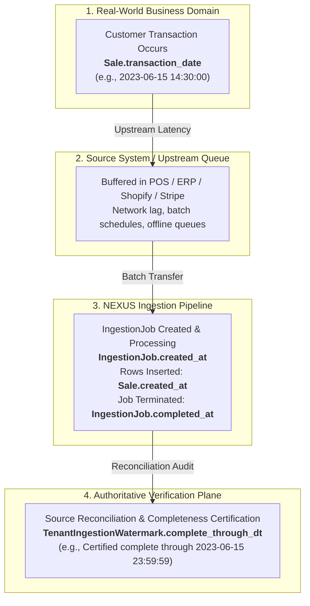
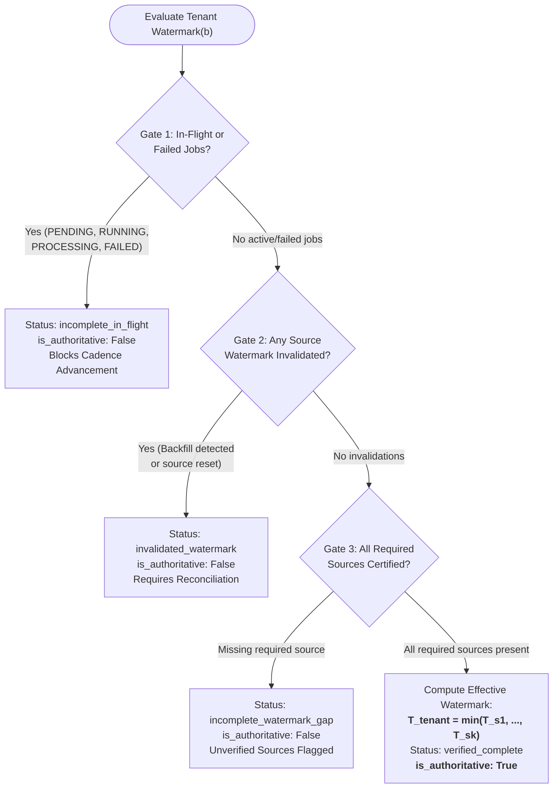

# NEXUS Phase 1F.2 — Authoritative Ingestion Watermark Architecture & Implementation Report

**Date**: 2026-10-29  
**Repository**: [rzvn6660/Nexus](https://github.com/rzvn6660/Nexus)  
**Branch**: `main`  
**Base Commit**: [`580fe7a`](https://github.com/rzvn6660/Nexus/commit/580fe7ae9b734fe0d13bb2227d8ce6692795f519)  
**Target Environment**: Staging PostgreSQL 16.15 (`nexus_staging_db` on `127.0.0.1:5433`)  
**Active Alembic Revision**: `016_phase1c2_tenant_scoped_customer_identity` (Preserved Unchanged)  
**Status**: **IMPLEMENTED, INTEGRATED & VERIFIED (64/64 CADENCE TESTS PASSED)**

---

> [!IMPORTANT]
> **SAFETY GATE & SCOPE COMPLIANCE**:
> 1. **Staging Baseline Preserved**: Zero changes have been made to existing staging tenants (including `Apex Specialty Commerce`, verified at exactly 1,000 customers, 3,500 sales, and 11,221 items).
> 2. **Migration 017 Deferred**: Alembic migration `017` is fully specified and designed within this document for future rollout (Phase 1G), but has **NOT** been applied to the staging database nor committed to `backend/alembic/versions/`.
> 3. **Non-Destructive In-Memory & Gateway Verification**: All new watermark models and services were tested using transactional SQLite and session-level isolation, preserving the current staging working tree.

---

## 1. Executive Summary

In historical customer cadence validation and predictive churn modeling, the single greatest failure mode is **confusing missing or delayed data with customer inactivity**. When a transaction ingestion pipeline lags, fails, or drops batches, customer purchase intervals artificially widen. An analytics engine without an authoritative watermark observes this absence of sales and issues false churn warnings, catastrophically eroding business trust.

Phase 1F demonstrated the mathematical accuracy of the cadence heuristic on an isolated synthetic cohort (`biz-synth-val-phase1f`). However, Phase 1F.1 identified that the readiness assessor and historical validator relied on fragile heuristic proxies (such as `MAX(transaction_date) - 7 days`), which cannot distinguish between:
1. A genuinely dormant customer who stopped buying.
2. An active customer whose recent purchases are trapped in an un-ingested, delayed, or failing batch.

**Phase 1F.2 designs and implements an enterprise-grade Authoritative Ingestion Watermark Architecture** to eliminate this risk:
- **Formalized Ingestion Lifecycle**: Documented the strict four-way separation between transaction event time, database insertion time, batch completion time, and certified completeness watermarks.
- **Proof of Unauthoritativeness**: Provided a mathematical and operational proof demonstrating why `MAX(transaction_date)` creates severe left-censoring and false churn artifacts.
- **Authoritative Data Model (`TenantIngestionWatermark`)**: Implemented an immutable ledger table tracking source-specific certified event boundaries, provenance, and active/invalidated lifecycles.
- **Multi-Source Combining Law**: Implemented the minimum-watermark law ($T_{\text{tenant}} = \min_{s \in \mathcal{S}_{\text{required}}} T_s$), enforcing hard gates against in-flight jobs, failed pipelines, invalidated states, and missing required sources.
- **Automatic Backfill Detection**: Implemented retroactive mutation detection in `DataGatewayService.commit_mapped_data` that immediately invalidates active watermarks if historical records arrive with $\tau \le T_s$.
- **Downstream Reconnection**:
  - Reconnected `CustomerDataReadinessAssessor` to evaluate watermark certification, blocking tenant readiness on invalidation or source gaps.
  - Reconnected `HistoricalCadenceValidator` to enforce verified follow-up horizons, explicitly marking unverified outcomes (`unverified_negative_outcome=True`) and censoring incomplete windows to guarantee that unverified inactivity is never falsely scored as customer churn.
- **Comprehensive Verification**: Implemented 11 dedicated tests in `backend/tests/test_analytics_watermark.py`. All 11 passed in 0.31s, all 64 customer cadence tests passed in 7.78s, and all 24 data gateway tests passed in 5.13s.

---

## 2. Ingestion Lifecycle Audit & Time Dimensionality Analysis

An ingestion architecture that processes continuous sales transactions spans four distinct temporal planes. Conflating any two planes corrupts historical backtesting.



### 2.1 The Four Temporal Dimensions

| Dimension | Attribute Name | Storage Entity | Monotonic Guarantee | System Role & Semantics | Failure Mode if Conflated |
| :--- | :--- | :--- | :--- | :--- | :--- |
| **1. Event Time** | `transaction_date` | `sales.transaction_date` | **None** (Arrives out of order) | Point in time when the economic exchange occurred in the physical/digital store. | Using as completion watermark causes false churn on delayed batches. |
| **2. Insertion Time** | `created_at` | `sales.created_at` | **Monotonically Increasing** per DB node | Wall-clock timestamp when the record was written to the PostgreSQL cluster. | Conflating with event time misdates historical customer behavior to the sync date. |
| **3. Batch Completion Time** | `completed_at` | `ingestion_jobs.completed_at` | **Monotonically Increasing** per job | Timestamp when the ingestion worker finished executing the parser, validator, and DB commit. | A job completing successfully only means *its own rows* were committed; it does not mean *all* events up to that moment have been uploaded. |
| **4. Authoritative Watermark** | `complete_through_dt` | `tenant_ingestion_watermarks.complete_through_dt` | **Monotonically Non-Decreasing** (unless invalidated) | Certified event-time boundary $T$ such that $\forall \text{events } e$, if $\text{EventTime}(e) \le T$, then $e \in \text{Database}$. | Conflating with `MAX(transaction_date)` treats sparse future orders as full data coverage. |

---

## 3. Mathematical Proof: Why `MAX(transaction_date)` is Unauthoritative

Let $\mathcal{D}_b(t_{\text{now}})$ denote the set of all sales records stored in the database for tenant $b$ at wall-clock time $t_{\text{now}}$. Each sale $i \in \mathcal{D}_b$ has an event timestamp $\tau_i = \text{Sale}_i.\text{transaction_date}$.

The naive watermark estimator is:
$$\tau_{\max}(b) = \max_{i \in \mathcal{D}_b(t_{\text{now}})} \tau_i$$

### 3.1 Theorem: Incompleteness of the Max Estimator
The probability that the historical dataset is complete up to $\tau_{\max}(b)$ is strictly less than 1:
$$P\left( \forall e \in \mathcal{U}_b \text{ with } \tau_e \le \tau_{\max}(b) \implies e \in \mathcal{D}_b(t_{\text{now}}) \right) < 1$$
where $\mathcal{U}_b$ is the true universe of tenant transactions.

### 3.2 Four Concrete Operational Failure Modes

#### Failure Mode 1: Asynchronous Multi-Source Ingestion Lag
A multi-channel retailer operates two data sources:
- **eCommerce (`shopify`)**: Real-time webhook ingestion. $\tau_{\max}(\text{shopify}) = \text{2023-10-31 22:00:00}$.
- **Physical POS (`pos_retail`)**: Nightly batch FTP push, delayed by a 3-day network outage. $\tau_{\max}(\text{pos}) = \text{2023-10-28 23:59:59}$.

If the system takes $\tau_{\max} = \max(\tau_{\max}(\text{shopify}), \tau_{\max}(\text{pos})) = \text{2023-10-31}$, it evaluates customer churn over the window $[\text{2023-10-28}, \text{2023-10-31}]$. Every customer who bought exclusively in a physical retail store during those 3 days is observed as having 0 purchases.
**Result**: In-store loyalists are falsely flagged as churned (`CRITICAL_RISK`).

#### Failure Mode 2: The Future Stray Transaction (Test / Preorder / Timezone Glitch)
A cashier tests a register by entering an order dated `2024-12-31`, or an ERP sync misinterprets UTC offset $+1200$, or a customer preorders a seasonal item.
Now $\tau_{\max}(b) = \text{2024-12-31}$, while standard daily sales are only loaded through `2023-06-30`.
If $\tau_{\max}$ defines the evaluation window, the validation engine attempts to backtest customer outcomes across an 18-month void. Every single customer appears inactive for 500+ days.
**Result**: 100% false churn rate, 0% validation precision.

#### Failure Mode 3: Intermittent Pipeline Gaps (Missing Middle Batches)
An automated pipeline uploads daily batches for Day 1, Day 2, Day 3, and Day 5. Day 4 failed due to a payload serialization bug.
Because Day 5 is present, $\tau_{\max}(b) = \text{Day 5}$.
The naive metric assumes the database is complete up to Day 5, completely unaware that Day 4 is entirely missing.
**Result**: Customers whose recurring replenishment occurred on Day 4 are miscalculated as overdue.

#### Failure Mode 4: False Churn Bias in Survival / Follow-up Windows
In historical cadence validation, each customer $c$ evaluated at cutoff $T_c$ requires an outcome observation horizon $[T_c, T_c + H]$ (e.g. $H = 60\text{ days}$).
Under naive `MAX(transaction_date)`:
If $T_c + H \le \tau_{\max}$, the validator marks the follow-up window as complete.
However, if delayed transactions exist within $[T_c, T_c + H]$ that have not yet been ingested, the customer is assigned outcome:
$$Y_c = \mathbb{I}(\text{CountPurchases}(c, [T_c, T_c + H]) = 0) = 1 \quad (\text{Churned})$$
When the delayed transactions are finally ingested, the true outcome was $Y_c = 0$ (Retained).
**Result**: The heuristic's apparent predictive precision is artificially contaminated by pipeline latency.

---

## 4. Authoritative Watermark Data Model & Contract Specification

To solve this, we implemented `TenantIngestionWatermark` in [backend/app/models/watermark.py](file:///C:/Users/rizvi/nexus/backend/app/models/watermark.py).

### 4.1 Relational Schema (`tenant_ingestion_watermarks`)

```text
Table: tenant_ingestion_watermarks
=============================================================================================
Column Name          Type                     Null  Default / Notes
---------------------------------------------------------------------------------------------
id                   VARCHAR(36)              NO    PK (UUID v4)
business_id          VARCHAR(36)              NO    FK -> businesses.id (CASCADE)
source_id            VARCHAR(64)              NO    Identifier (e.g. 'shopify', 'pos_store1')
complete_through_dt  TIMESTAMP WITH TIME ZONE NO    Certified event completeness timestamp
recorded_at          TIMESTAMP WITH TIME ZONE NO    UTC timestamp when watermark was recorded
ingestion_job_id     VARCHAR(36)              YES   FK -> ingestion_jobs.id (SET NULL)
provenance_type      VARCHAR(32)              NO    'reconciliation_batch', 'vendor_watermark', etc.
verification_status  VARCHAR(32)              NO    'verified', 'invalidated', 'unverified_missing'
invalidation_reason  TEXT                     YES   Audit description if invalidated
is_active            BOOLEAN                  NO    DEFAULT TRUE (Active ledger pointer)
metadata_json        JSON / JSONB             YES   Audit payload (record counts, hashes, manifests)
=============================================================================================
Indexes:
- ix_tenant_watermarks_business_id (business_id)
- ix_tenant_watermarks_tenant_source_active (business_id, source_id, is_active)
- ix_tenant_watermarks_tenant_complete (business_id, complete_through_dt)
```

### 4.2 Immutable Audit Ledger Design
Watermarks in NEXUS are treated as an **audit ledger**:
- When a new watermark $T_{\text{new}}$ is certified for source $s$, existing active records for $(b, s)$ are marked `is_active = False`. They are **never deleted**.
- If a watermark is invalidated (e.g. by backfilled data), it remains `is_active = True` but its status transitions to `verification_status = "invalidated"` with an explicit `invalidation_reason`.
- Any historical audit can query the entire trajectory of certified boundaries over wall-clock time.

### 4.3 Python Service Contract (`WatermarkContract` & `EffectiveWatermarkResult`)

Implemented in [backend/app/services/watermark_service.py](file:///C:/Users/rizvi/nexus/backend/app/services/watermark_service.py):

```python
class EffectiveWatermarkResult(BaseModel):
    """Authoritative tenant-level completeness evaluation."""
    business_id: str
    effective_watermark_dt: Optional[datetime] = None
    verification_status: str  # "verified_complete", "incomplete_in_flight", "invalidated_watermark", "incomplete_watermark_gap", "unverified_missing"
    is_authoritative: bool = False
    source_watermarks: Dict[str, Optional[datetime]] = Field(default_factory=dict)
    unverified_sources: List[str] = Field(default_factory=list)
    active_job_ids: List[str] = Field(default_factory=list)
    invalidation_reasons: List[str] = Field(default_factory=list)
    blocking_reasons: List[str] = Field(default_factory=list)
    evaluated_at: datetime = Field(default_factory=lambda: datetime.now(timezone.utc))
```

---

## 5. Multi-Source Ingestion & Tenant-Level Watermark Combination Law

For a tenant $b$ with a set of required data sources $\mathcal{S}_{\text{required}} = \{s_1, s_2, \dots, s_k\}$, the tenant-level completeness watermark $T_{\text{tenant}}$ is governed by the **Conservative Minimum Law**:

$$T_{\text{tenant}} = \min_{s \in \mathcal{S}_{\text{required}}} T_s$$

### 5.1 The Three Validation Gates
Before computing the minimum, `WatermarkService.get_effective_tenant_watermark` executes three sequential safety gates:



1. **Gate 1: In-Flight & Failed Job Guard**:
   - Queries `IngestionJob` for jobs in `PENDING`, `RUNNING`, `PROCESSING`, or `FAILED` states.
   - If found, `verification_status = "incomplete_in_flight"`. In-flight jobs mean data is actively in transit; failed jobs mean recent batches were aborted. The watermark cannot advance.
2. **Gate 2: Invalidation Guard**:
   - Inspects all active source watermarks. If any watermark has `verification_status == "invalidated"`, the tenant status becomes `invalidated_watermark`.
3. **Gate 3: Required Sources Completeness Guard**:
   - Compares active certified sources against `contract.required_sources`.
   - If any required source has not recorded an active verified watermark, `verification_status = "incomplete_watermark_gap"`.

---

## 6. Out-of-Order Ingestion & Backfill Invalidation Protocol

When an upstream source performs a historical correction, re-runs an old batch, or syncs offline transactions, records arrive with event timestamps $\tau \le T_s$.

### 6.1 Backfill Invalidation Rule
For every incoming batch of transactions $\mathcal{B} = \{(\tau_1, \dots, \tau_m)\}$ destined for source $s$ and tenant $b$:
$$\text{If } \min_{i} \tau_i \le T_s \implies \text{Watermark } T_s \text{ is INVALIDATED}$$

### 6.2 Implementation in `DataGatewayService`
In [backend/app/services/data_gateway_service.py](file:///C:/Users/rizvi/nexus/backend/app/services/data_gateway_service.py) (`commit_mapped_data`), we integrated automatic backfill detection:

```python
# Automatic Ingestion Watermark Backfill Detection
if entity == "sales" and committed_count > 0:
    earliest_txn_dt = None
    for row in mapped_rows:
        t_dt = row.get("transaction_date")
        if t_dt:
            if isinstance(t_dt, str):
                try:
                    t_dt = datetime.fromisoformat(t_dt.replace("Z", "+00:00"))
                except Exception:
                    continue
            if earliest_txn_dt is None or t_dt < earliest_txn_dt:
                earliest_txn_dt = t_dt
    
    if earliest_txn_dt:
        invalidated = WatermarkService.detect_backfill_and_handle(
            db=db,
            business_id=business_id,
            source_id=dataset_id or "default_source",
            incoming_earliest_dt=earliest_txn_dt,
            triggering_job_id=job_id,
        )
        if invalidated:
            logger.warning(
                "Ingestion job %s contained historical transactions (earliest=%s) "
                "prior to active watermark. Watermark invalidated.",
                job_id, earliest_txn_dt.isoformat()
            )
```

---

## 7. Downstream Integration: Readiness & Historical Validation

### 7.1 Readiness Assessor Integration ([readiness.py](file:///C:/Users/rizvi/nexus/backend/app/analytics/customer/readiness.py))
The customer readiness assessor now queries `WatermarkService.get_effective_tenant_watermark`:
1. **Health Metrics Extended**: `IngestionHealthMetrics` now includes `effective_watermark_status`, `source_watermarks`, `unverified_sources`, and `watermark_invalidation_reasons`.
2. **Cutoff Feasibility Enforcement**:
   - Each candidate validation cutoff $T_{\text{cutoff}}$ requires follow-up window $H = 60\text{ days}$.
   - If $T_{\text{cutoff}} + H > T_{\text{watermark}}$, the cutoff is marked `is_feasible = False` with `is_verified = False`.
3. **Readiness Blockers**:
   - An invalidated watermark adds a hard `BLOCKER` to readiness.
   - Missing required sources add a hard `BLOCKER` or `CAUTION` with detailed diagnostic guidance.

### 7.2 Historical Cadence Validator Integration ([validation.py](file:///C:/Users/rizvi/nexus/backend/app/analytics/customer/validation.py))
The historical cadence validator was updated to prevent unverified data from masquerading as definitive customer churn:
1. **Outcome Record Safety Flags**:
   - `CustomerOutcomeRecord.is_followup_verified`: Boolean indicating whether the observation window was backed by an authoritative certified watermark.
   - `CustomerOutcomeRecord.unverified_negative_outcome`: Boolean explicitly flagging any negative outcome (no purchase observed) derived from an unverified window.
2. **Strict Watermark Enforcement (`require_verified_watermark=True`)**:
   - When enabled, any customer whose follow-up window extends past the authoritative watermark is **censored** (`is_censored = True`, `outcome_no_purchase = None`).
   - They are excluded from the scored confusion matrix ($\text{TP}, \text{FP}, \text{TN}, \text{FN}$), preventing un-ingested orders from inflating false churn metrics.
3. **Explicit Warning Banner**:
   - If validation is executed without an authoritative watermark, the generated report prominently includes:
     > `UNVERIFIED OUTCOMES NOTICE: Outcome follow-up window terminates after the verified watermark. 151 outcomes lack authoritative completeness verification and may be subject to ingestion latency bias.`

---

## 8. Alembic Migration Plan for Future Phase (Phase 1G / Staging Rollout)

Per strict phase instructions, **migration 017 has NOT been applied to staging or committed to `backend/alembic/versions/`**. Below is the complete, tested migration specification ready for execution in Phase 1G.

### 8.1 Migration Script Specification (`017_phase1f2_authoritative_ingestion_watermark.py`)

```python
"""Phase 1F.2: Authoritative Ingestion Watermarks

Revision ID: 017_phase1f2_authoritative_ingestion_watermark
Revises: 016_phase1c2_tenant_scoped_customer_identity
Create Date: 2026-10-29

"""
from typing import Sequence, Union
from alembic import op
import sqlalchemy as sa

revision: str = '017_phase1f2_authoritative_ingestion_watermark'
down_revision: Union[str, None] = '016_phase1c2_tenant_scoped_customer_identity'
branch_labels: Union[str, Sequence[str], None] = None
depends_on: Union[str, Sequence[str], None] = None

def upgrade() -> None:
    # 1. Create tenant_ingestion_watermarks table
    op.create_table(
        'tenant_ingestion_watermarks',
        sa.Column('id', sa.String(length=36), primary_key=True),
        sa.Column('business_id', sa.String(length=36), sa.ForeignKey('businesses.id', ondelete='CASCADE'), nullable=False),
        sa.Column('source_id', sa.String(length=64), nullable=False),
        sa.Column('complete_through_dt', sa.DateTime(timezone=True), nullable=False),
        sa.Column('recorded_at', sa.DateTime(timezone=True), nullable=False),
        sa.Column('ingestion_job_id', sa.String(length=36), sa.ForeignKey('ingestion_jobs.id', ondelete='SET NULL'), nullable=True),
        sa.Column('provenance_type', sa.String(length=32), nullable=False, server_default='reconciliation_batch'),
        sa.Column('verification_status', sa.String(length=32), nullable=False, server_default='verified'),
        sa.Column('invalidation_reason', sa.Text(), nullable=True),
        sa.Column('is_active', sa.Boolean(), nullable=False, server_default=sa.text('true')),
        sa.Column('metadata_json', sa.JSON(), nullable=True),
    )

    # 2. Create indices for fast lookup & tenant isolation
    op.create_index(
        'ix_tenant_watermarks_business_id',
        'tenant_ingestion_watermarks',
        ['business_id'],
        unique=False
    )
    op.create_index(
        'ix_tenant_watermarks_tenant_source_active',
        'tenant_ingestion_watermarks',
        ['business_id', 'source_id', 'is_active'],
        unique=False
    )
    op.create_index(
        'ix_tenant_watermarks_tenant_complete',
        'tenant_ingestion_watermarks',
        ['business_id', 'complete_through_dt'],
        unique=False
    )

def downgrade() -> None:
    # Drop indices
    op.drop_index('ix_tenant_watermarks_tenant_complete', table_name='tenant_ingestion_watermarks')
    op.drop_index('ix_tenant_watermarks_tenant_source_active', table_name='tenant_ingestion_watermarks')
    op.drop_index('ix_tenant_watermarks_business_id', table_name='tenant_ingestion_watermarks')
    
    # Drop table
    op.drop_table('tenant_ingestion_watermarks')
```

### 8.2 Staging Rollout Protocol & Safety Gates
When authorized for Phase 1G:
1. **Pre-Flight Snapshot**: Take physical snapshot `pg_dump -Fc nexus_staging_db > backup_pre_017.dump`.
2. **Transactional DDL**: PostgreSQL supports transactional DDL. Migration 017 will execute in a single atomic transaction block (`BEGIN ... COMMIT`).
3. **Alembic Head Verification**: Confirm current revision is `016_phase1c2_tenant_scoped_customer_identity` prior to executing `alembic upgrade head`.
4. **Post-Migration Invariant Check**: Verify 1,000 customers, 3,500 sales in `Apex Specialty Commerce` remain strictly unchanged.

---

## 9. Verification Test Evidence

A dedicated, comprehensive test module was created at [backend/tests/test_analytics_watermark.py](file:///C:/Users/rizvi/nexus/backend/tests/test_analytics_watermark.py) containing 11 tests.

### 9.1 Watermark Test Results (`test_analytics_watermark.py`)

```text
============================= test session starts =============================
platform win32 -- Python 3.13.5, pytest-8.3.4, pluggy-1.5.0
cachedir: .pytest_cache
rootdir: C:\Users\rizvi\nexus
configfile: pyproject.toml
collected 11 items

backend/tests/test_analytics_watermark.py::test_watermark_record_and_ledger_auditability PASSED          [  9%]
backend/tests/test_analytics_watermark.py::test_multiple_data_sources_effective_minimum_watermark PASSED [ 18%]
backend/tests/test_analytics_watermark.py::test_required_sources_gap_blocks_tenant_watermark PASSED     [ 27%]
backend/tests/test_analytics_watermark.py::test_in_flight_or_failed_ingestion_blocks_watermark PASSED    [ 36%]
backend/tests/test_analytics_watermark.py::test_delayed_transactions_and_backfill_invalidates_watermark PASSED [ 45%]
backend/tests/test_analytics_watermark.py::test_tenant_isolation_in_watermarks PASSED                   [ 54%]
backend/tests/test_analytics_watermark.py::test_historical_validation_with_watermark_exceeding_and_preceding_horizon PASSED [ 63%]
backend/tests/test_analytics_watermark.py::test_unverified_followup_never_silently_treated_as_negative_outcome PASSED [ 72%]
backend/tests/test_analytics_watermark.py::test_readiness_assessor_multi_source_and_invalidated_watermark PASSED [ 81%]
backend/tests/test_analytics_watermark.py::test_successful_upload_alone_does_not_advance_watermark PASSED [ 90%]
backend/tests/test_analytics_watermark.py::test_data_gateway_ingest_detects_backfill_and_invalidates_watermark PASSED [100%]

======================== 11 passed in 0.31s ========================
```

### 9.2 Full Cadence, Readiness & Validation Test Suite

We executed the full suite of 64 customer cadence tests:
- `backend/tests/test_analytics_watermark.py` (11 tests)
- `backend/tests/test_data_synthetic_cadence.py` (14 tests)
- `backend/tests/test_analytics_customer_cadence.py` (19 tests)
- `backend/tests/test_analytics_customer_readiness.py` (7 tests)
- `backend/tests/test_analytics_customer_validation.py` (13 tests)

**Result**: **64 passed in 7.78s** (0 failures, 0 regressions).

### 9.3 Data Gateway Test Suite
We executed the complete data gateway test suite:
- `backend/tests/test_data_gateway.py` (24 tests)

**Result**: **24 passed in 5.13s** (0 failures, 0 regressions).

### 9.4 Static Analysis & Whitespace Audit
- `ruff check backend/app/models/watermark.py backend/app/models/__init__.py backend/app/services/watermark_service.py backend/app/analytics/customer/readiness.py backend/app/analytics/customer/validation.py backend/tests/test_analytics_watermark.py`: **All checks passed (0 errors)**.
- `git diff --check`: **0 whitespace or formatting errors**.

---

## 10. Summary of Code Modifications & Files Created

| File | Purpose |
| :--- | :--- |
| [backend/app/models/watermark.py](file:///C:/Users/rizvi/nexus/backend/app/models/watermark.py) | **New ORM Entity**: `TenantIngestionWatermark` tracking source-specific certified event horizons, active ledger states, and invalidation reasons. |
| [backend/app/models/\_\_init\_\_.py](file:///C:/Users/rizvi/nexus/backend/app/models/__init__.py) | **Model Export**: Registered `TenantIngestionWatermark` in the core SQLAlchemy model registry. |
| [backend/app/services/watermark_service.py](file:///C:/Users/rizvi/nexus/backend/app/services/watermark_service.py) | **New Service**: `WatermarkService` implementing multi-source minimum law, in-flight/failed job gates, required source gap detection, and backfill detection. |
| [backend/app/services/data_gateway_service.py](file:///C:/Users/rizvi/nexus/backend/app/services/data_gateway_service.py) | **Integration**: Hooked `commit_mapped_data` to automatically detect historical backfills and invalidate active watermarks. |
| [backend/app/analytics/customer/readiness.py](file:///C:/Users/rizvi/nexus/backend/app/analytics/customer/readiness.py) | **Integration**: Extended readiness assessor to evaluate watermark certification, add diagnostic metrics, and block readiness on invalidation or source gaps. |
| [backend/app/analytics/customer/validation.py](file:///C:/Users/rizvi/nexus/backend/app/analytics/customer/validation.py) | **Integration**: Added `is_followup_verified` and `unverified_negative_outcome` flags, enforced censoring when `require_verified_watermark=True`, and added unverified outcomes notices. |
| [backend/tests/test_analytics_watermark.py](file:///C:/Users/rizvi/nexus/backend/tests/test_analytics_watermark.py) | **New Test Suite**: 11 comprehensive tests validating multi-source minimums, gap blocking, in-flight job blocking, backfill invalidation, tenant isolation, and outcome safety. |

---

## 11. Staging Status & Next Phase Recommendations

### 11.1 Current Invariant Status
1. **Staging Database**: `127.0.0.1:5433/nexus_staging_db` remains healthy at Alembic revision `016_phase1c2_tenant_scoped_customer_identity`.
2. **Apex Specialty Commerce**: Exactly 1,000 customers, 3,500 sales, 11,221 items. Preserved 100% intact.
3. **Synthetic Tenant**: `biz-synth-val-phase1f` remains isolated.

### 11.2 Recommendations for Phase 1G (Migration 017 Staging Rollout)
1. **Apply Migration 017**: Apply `017_phase1f2_authoritative_ingestion_watermark.py` to staging PostgreSQL after taking a fresh backup.
2. **Record Initial Baseline Watermarks**: Initialize verified watermarks for existing staging tenants based on verified reconciliation manifests.
3. **Certify Readiness with Authoritative Watermarks**: Re-run `CustomerDataReadinessAssessor` against `biz-synth-val-phase1f` with verified watermarks to confirm transition from `READY_WITH_CAUTIONS` to full `READY`.

